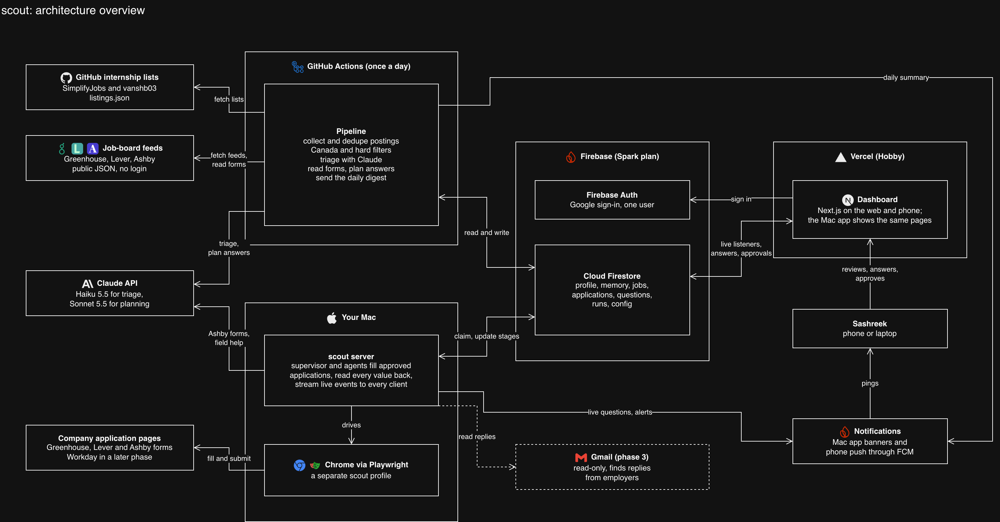
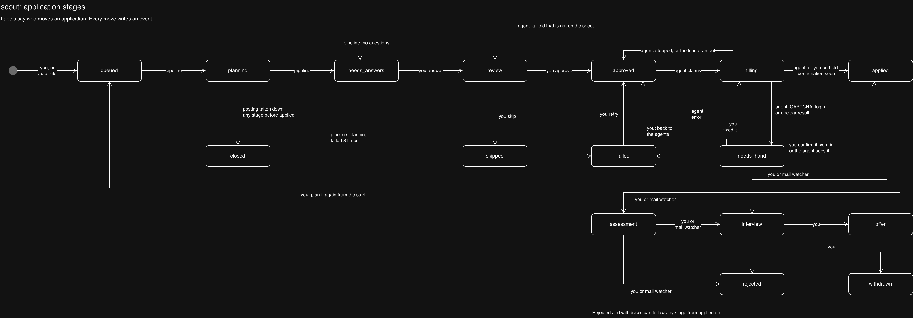
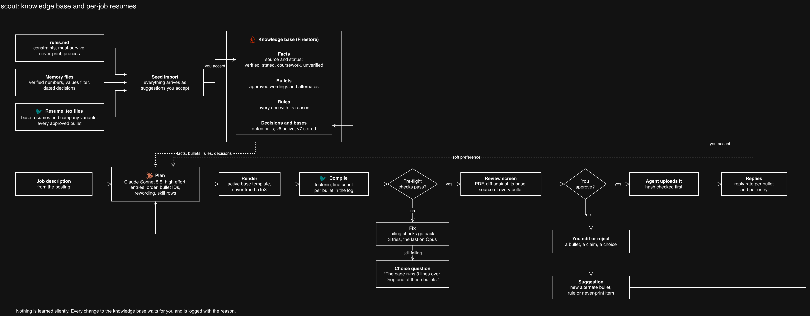
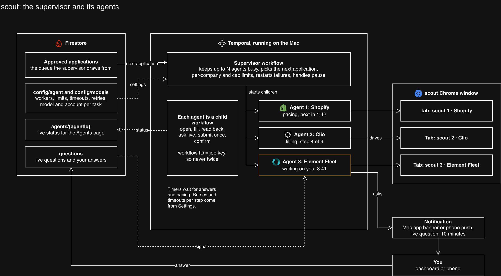
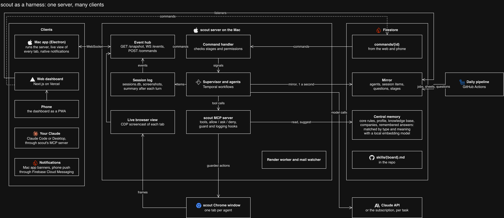
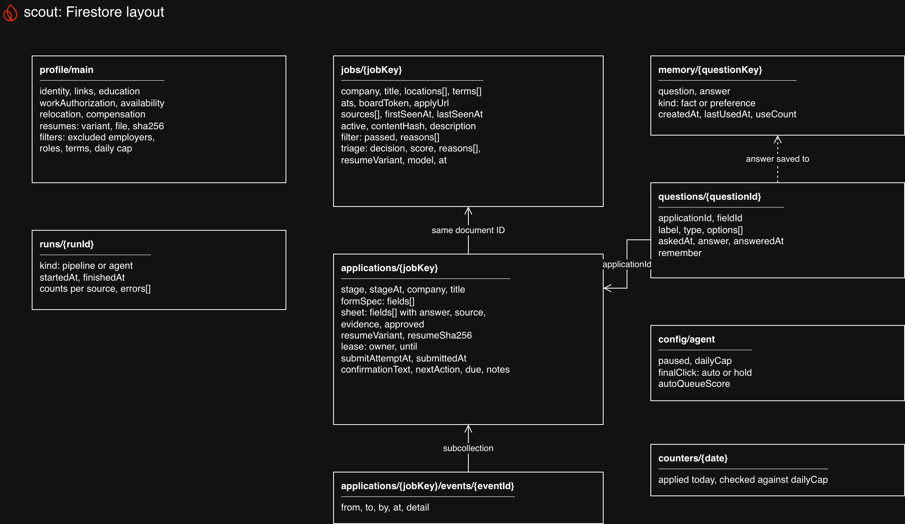
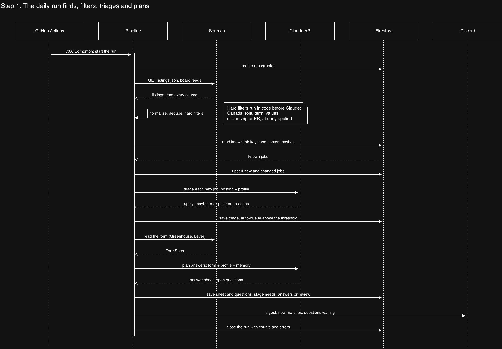
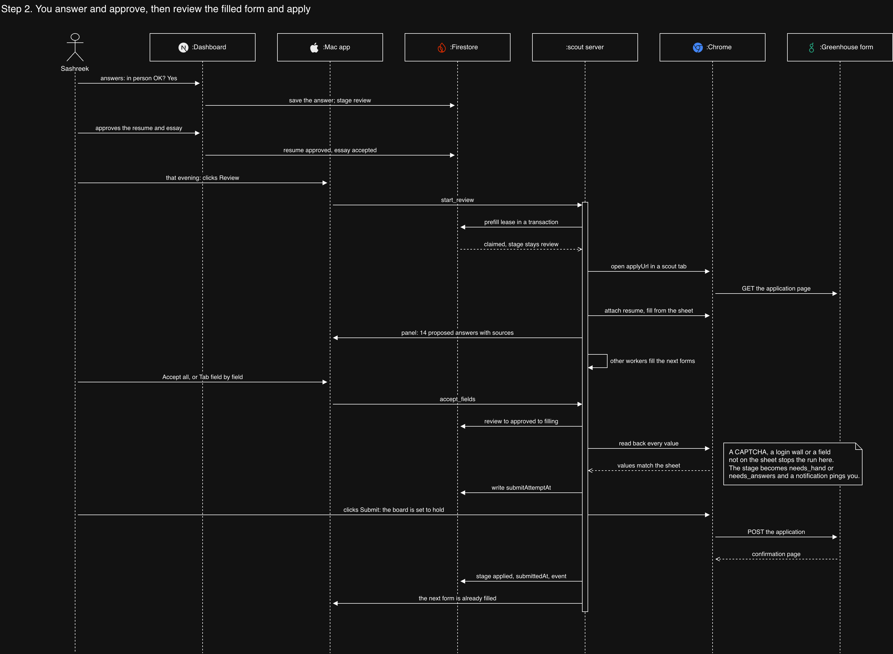

# scout architecture

Sashreek Addanki · November 5, 2026

> AI use: Claude Opus 5.5 (Anthropic), used through Claude Code, helped write
> this document and its diagrams on November 5, 2026, working from decisions
> Sashreek made. It also checked the job sources, the job-board form APIs and
> the free-tier figures in section 6 against the live endpoints and pricing
> pages on that date. Sashreek's review is pending.

This page explains how scout is put together. scout finds internship and co-op postings in Canada, decides which ones fit, writes a one-page resume for each job from what it knows about Sashreek, fills in the application on the company's own site, and asks over the dashboard whenever it doesn't know an answer. It keeps learning about him the way a good assistant does: it remembers every fact, every correction and every decision he makes, with the reason, and never asks him the same thing twice. Section 3 explains the architecture style and why it isn't one big AI agent. Section 7 follows one job from the daily run to "applied", so you can see every part working in one story. Section 9 is the practical part: where files live, what to name things and how to add a new job board.

`docs/PLAN.md` holds the first plan. Where the two differ, this file wins.

## Contents

1. [The big picture](#1-the-big-picture)
2. [What scout has to do](#2-what-scout-has-to-do)
3. [Architecture style](#3-architecture-style)
4. [Design decisions and why we made them](#4-design-decisions-and-why-we-made-them)
5. [The parts](#5-the-parts)
5b. [The knowledge base and per-job resumes](#5b-the-knowledge-base-and-per-job-resumes)
5c. [Running agents in parallel](#5c-running-agents-in-parallel)
5d. [scout as a harness](#5d-scout-as-a-harness)
6. [Data in Firebase](#6-data-in-firebase)
7. [One job, front to back](#7-one-job-front-to-back)
8. [When things go wrong](#8-when-things-go-wrong)
9. [Working in the codebase](#9-working-in-the-codebase)
10. [Build order and open questions](#10-build-order-and-open-questions)

## 1. The big picture

scout runs in four places. A daily job in GitHub Actions finds and ranks postings and plans the answers. Firestore holds everything. A dashboard on Vercel is where Sashreek answers questions and approves applications. An agent on his Mac does the one job that needs a real browser, which is filling in and submitting the form.



| Where | What runs there | When |
|---|---|---|
| GitHub Actions | The pipeline: collect, filter, triage, read forms, plan answers, send the digest | Once a day at 14:00 UTC, which is 7:00 in Edmonton in winter and 8:00 in summer |
| Firebase | Firestore with every job, application, question and the profile. Auth for the dashboard. | Always on |
| Vercel | The dashboard | Always on |
| Sashreek's Mac | The scout server: the Temporal supervisor and its agents, the render worker, the mail watcher, scout's MCP server and the live event stream. The Mac app runs it and shows it (section 5d). | From login, while the Mac is awake |

| Part | What we use | Why |
|---|---|---|
| Language | TypeScript everywhere | The pipeline, the agent and the dashboard share one set of types, so a Job written by the pipeline is the same Job the dashboard reads. |
| Repo layout | pnpm workspaces: three apps and three packages | Section 9 shows the folders. |
| Data shapes | Zod | One schema gives the TypeScript type and checks data at runtime. It checks feed data, Firestore documents and Claude's output. |
| AI | Claude Opus 5.5 through the Anthropic TypeScript SDK | Triage and answer planning use structured output. The agent's fallback uses the SDK's tool runner. |
| Browser | Playwright driving Chrome with its own scout profile | Runs on the Mac, headed, so Sashreek can watch or take over. |
| Database | Cloud Firestore, Standard edition | Live listeners for the dashboard and transactions for claiming work. |
| Sign-in | Firebase Auth with Google | One user. Security rules let only his account in. |
| Dashboard | Next.js on Vercel's Hobby plan, with shadcn/ui | Hobby is for personal, non-commercial use, which scout is. |
| Schedule | GitHub Actions cron | Free inside the monthly allowance for a private repo, and no server to look after. |
| Notifications | macOS notifications from the Mac app, and web push to the phone through Firebase Cloud Messaging | scout asks and he answers in the same app, so there is no second channel to check. FCM is free on the Spark plan. |
| Tests | Vitest, with saved copies of real feeds and forms | Tests never hit a live job board. |

## 2. What scout has to do

scout has to:

- Find internship and co-op postings in Canada every day from public sources.
- Take a job link from him, found anywhere, and apply on the company's own site.
- Drop the postings Sashreek can't or won't take, using rules he can read in code.
- Rank the rest and say why.
- Write a one-page resume for every application, tailored to the job description by the same rules used by hand today, and only from facts that are verified.
- Fill in applications on Greenhouse, Lever and Ashby first, and on Workday later.
- Give every factual answer a source in his profile or in an answer he gave before.
- Ask him when it doesn't know, and never ask the same question twice.
- Submit nothing he hasn't approved.
- Track every application from "found" to "offer".
- Keep learning about him: every correction, edit and decision is stored with its reason and applied from then on.

scout will not:

- Touch LinkedIn. LinkedIn's User Agreement bans automated access, and his main account is not worth the risk.
- Create accounts on job sites. He creates Workday accounts himself.
- Solve CAPTCHAs. A CAPTCHA hands the job to him.
- Send a cover letter, essay answer or resume he hasn't approved.
- Print a claim on a resume that isn't backed by a verified fact, unless he turns that on for one application on purpose.
- Apply to more than the daily cap. It defaults to 20, can be raised, and can be turned off.
- Support more than one user.

## 3. Architecture style

scout is a **pipeline with a state machine, and adapters for each job board**. There is no single app with screens and controllers, so MVC doesn't fit. Three ideas carry the design.

**A pipeline of small steps.** Each daily run goes collect, normalize, filter, triage, read forms, plan answers, digest. Each step reads from Firestore and writes back to it, so a crashed run picks up where it stopped the next day. Every step can run again safely, because document IDs come from the posting itself. Section 6 explains how.

**A state machine for every application.** An application is always in exactly one stage, and only certain moves are allowed. The stage list and the allowed moves live in one file, `packages/core/stages.ts`. Every move writes an event, so each application keeps a full history of who moved it and when.



| Stage | Meaning | Who moves it on |
|---|---|---|
| `queued` | Chosen to apply, by Sashreek or by the auto rule | The pipeline |
| `planning` | The form is being read and the answers planned | The pipeline |
| `needs_answers` | Questions are waiting for Sashreek | Sashreek, by answering in the dashboard |
| `review` | The answer sheet is ready | Sashreek: approve or skip |
| `approved` | Ready for the agent | The agent, when it claims it |
| `filling` | The agent is working in the browser | The agent |
| `needs_hand` | A CAPTCHA, a login wall, or a result the agent can't read | Sashreek, at the Mac |
| `applied` | The company's confirmation was seen | Sashreek or the mail watcher |
| `assessment`, `interview`, `offer` | After applying | Sashreek or the mail watcher |
| `rejected`, `withdrawn` | Closed after applying | Final |
| `skipped`, `closed`, `failed` | Skipped at review, posting taken down, or an error. A failed one can be retried. | Final, except `failed` |

**Adapters at the edges.** Code that talks to the outside sits behind small interfaces called ports, in `packages/core/ports.ts`. Each job board gets its own adapter. The core never imports Playwright, Firestore or the Anthropic SDK, so it is tested without a network.

```ts
interface JobSource  { id: string; fetch(): Promise<Listing[]> }
interface FormReader { canRead(job: Job): boolean; read(job: Job): Promise<FormSpec> }
interface FormFiller { canFill(app: Application): boolean; fill(page: Page, sheet: Sheet): Promise<FillReport>; submit(page: Page): Promise<SubmitResult> }
interface Store      { /* jobs, applications, questions, memory, profile, runs */ }
interface Notifier   { send(message: Notice): Promise<void> }
interface Llm        { triage(job: Job, profile: Profile): Promise<Triage>; plan(input: PlanInput): Promise<PlanResult> }
```

**Why not one big agent?** One Claude agent with a browser could do all of this. It would also be slow, expensive and hard to test, and it would make different choices on different days. Most of scout's work is plain code: download a JSON file, match a city name, copy an email address into a field. Claude does the four jobs that need judgement:

1. Triage: does this posting fit him, and which side of his work should lead?
2. Resume tailoring: which entries, bullets, titles and skill rows fit this job description, and how to reword a bullet in the job's vocabulary without changing what it claims.
3. Answer planning: which profile fact answers "Are you legally eligible to work in Canada?", and what goes in "Why do you want to work here?"
4. A fallback in the browser when a filler can't find a field on the page. Even then it may only type values from the approved sheet.

Everything Claude writes is checked by code against the knowledge base before Sashreek sees it.

## 4. Design decisions and why we made them

| Decision | Why |
|---|---|
| Jobs come from two GitHub internship lists and public job-board feeds, never LinkedIn. | LinkedIn bans automated access. The GitHub lists and feeds are public JSON, carry structured fields like location and term, and need no login. |
| Canada only, checked in code. | He is on a study permit with a co-op work permit, so Canadian roles are the ones he can take. A location rule in code is easy to test. |
| Values and eligibility filters run in code before Claude sees a posting. | Defence, weapons and surveillance employers are out on values grounds, and SWPP, FSWEP and citizen-or-PR postings are closed to him. Code rules are predictable and testable. Triage still flags anything the rules miss. General Dynamics postings were in the Canadian list on November 5, 2026, so this matters from day one. |
| scout reads the application form before any browser opens. | Greenhouse publishes each job's full form through a public API, with field types and which fields are required. Lever puts its custom questions in the apply page's HTML. So scout can plan every answer and ask every question in one batch, days before the agent runs. |
| Sashreek approves the answer sheet, not a screenshot. | The browser doesn't have to wait open for hours. The agent fills from the approved sheet, reads every value back from the page, and stops if anything differs. |
| Every factual answer cites a profile field or a remembered answer. | Wrong answers on work authorization or availability can cost him the job. The planner may only draft free-text answers like "why us", and those always go to him. |
| The profile and remembered answers live in Firestore. The YAML files in `profile/` only seed it. | The pipeline in GitHub Actions needs the profile, and he edits it from the dashboard. One copy means no drift. |
| A job's document ID is built from the posting, like `greenhouse:tribalscale:4726999006`. The application uses the same ID. | Running the collector twice updates the same documents instead of making copies. Using the same ID for the application means there can only be one application per posting. |
| GitHub Actions runs the schedule. No server, no n8n, no Cybera. | The daily run is a few minutes of HTTP calls and Firestore writes. Actions does that for free in a private repo. Cybera's Rapid Access Cloud is for research and testing, not ongoing hosting. |
| The browser work runs on the Mac in its own Chrome profile. | Chrome locks a profile while it's open, and his daily profile shouldn't carry automation. Running locally also keeps his Workday logins on his own machine. |
| No Firebase Storage in the first version. | Storage needs the Blaze plan since February 3, 2026. Posting text fits in Firestore. Screenshots stay on the Mac under `runs/`. Moving to Blaze later only adds screenshots to the dashboard. |
| One user, and the rules allow one account. | It is a personal tool. Rules for one known account are short and easy to check. |
| Notifications come from scout itself: macOS notifications on the Mac and push notifications on the phone. No Discord. | The app that asks the question is where he answers it, so the alert should open it there. Sashreek dropped Discord on November 5, 2026. |
| A supervisor written in code runs the agents, on Temporal. | Temporal gives child workflows, signals, timers and retries out of the box, and a workflow ID per job key makes a double application impossible. A model supervising models would add mistakes, not remove them. |
| Model, effort and account are set per task. The API is the default, and the Claude subscription is an opt-in. | He can trade cost for quality per task, and use his plan where it's allowed, with an automatic fall back to the API when the plan's limit is hit. |
| Boards without a hand-written filler use Stagehand to find fields, while scout types the values. | It covers about a third of postings without giving a model free control of the form. |
| He sets how many agents run in parallel, 3 by default. | Approvals no longer gate throughput once 20 a day are queued. Workers share one Chrome window as tabs, because Chrome locks a profile to one process and logins should be shared. |
| A worker asks live when it meets a question, and holds the form for 10 minutes. | Most new questions take him seconds to answer. Holding the tab means the application finishes now instead of a day later, and other workers keep going meanwhile. |
| The agent claims work with a Firestore transaction and a lease. | Two agent runs can never fill the same application. A crashed run's lease runs out and someone can pick the work up again. |
| The agent writes `submitAttemptAt` before it clicks Submit. | If it crashes between the click and the confirmation, a retry could apply twice. With the marker set, a retry goes to `needs_hand` and he checks his email first. |
| Claude Opus 5.5 at low effort for triage, medium for planning, with server-side refusal fallback. | Triage is a short decision. Planning needs more care. Fallback reruns a refused request on another model in the same call, and the code still checks `stop_reason` before reading the answer. |
| The stable part of every prompt is cached. | The instructions and his profile are the same on every call. Cache reads cost $0.20 per million tokens, against $4 for normal input. |
| Every application gets its own resume, built from the active base resume by the rules in `rules.md`. | This is the process that already works by hand. scout automates it instead of inventing a new one. Fixed variants can't move a project up for one job or swap mint's SDK bullet for its observability bullet for an SRE posting. |
| The knowledge base is modelled on the assistant memory used today: facts with sources, feedback with the reason, and dated decisions. | Facts alone aren't enough. "Never write '100% cited'" only stays fixed if the reason is stored with it, and "no dates on projects, his call" stops the same question coming back. |
| The base resume is a setting, not a constant. | v6 is the base today and v7 is waiting. Bases are stored side by side, one is active, and switching is one action that shows exactly what changed. |
| The knowledge base is seeded from `rules.md`, the memory files and the resume `.tex` files. | scout starts with everything already settled over months of review, not from zero. |
| scout learns only what Sashreek confirms. | Every edit or correction becomes a suggested rule or bullet. Nothing becomes a fact or a rule until he accepts it, so the agent can't drift into claims he never made. |
| A resume is rendered from a template, not written as free LaTeX by Claude. | Claude picks and rewords bullets. Code renders the `.tex` from the active base's preamble and macros, so the layout and fonts are always the same and every check can run on it. |
| The pre-flight list from `rules.md` runs as code on every resume. | One page, line counts, bullet counts, bold spans, banned words, repeated verbs, never-print terms and number provenance are all checkable by a machine. The read-it-aloud test stays with him. |
| Resume PDFs are stored in Firestore as base64, about 80 KB each. | It keeps scout on the free Spark plan. The agent uploads exactly the approved file and checks its hash. |
| He can add any job by pasting its link, but scout never opens LinkedIn, Indeed, Glassdoor or Handshake. | Those sites ban automated access. Their links still carry the title and company, which is enough to find the same job on the company's own board. |
| scout starts with an empty application history. | Past applications from before scout aren't imported. Sashreek decided this on November 5, 2026. |
| scout is built like a coding harness: one server on the Mac, many clients, typed events. | Claude Code, Codex, OpenCode and t3code all converged on this. It gives live updates on every client from one source, and a protocol the Mac app and the web share. |
| Every application is a session with its own log and a summary written after each turn. | Memory per application, like a chat thread. A later turn, like an interview invite weeks after applying, starts from the summary instead of rereading everything. |
| Central memory has six layers, from always-loaded rules to company memory and board skills. | What one session learns reaches every later session. Loading each layer only when needed keeps prompts short and cheap. |
| scout writes its own MCP server for every tool a model can call, with allow, ask or deny policies and guard hooks. | The API and the subscription path get the same tools. Guards are code, so a model can't type a value that isn't on the approved sheet. |
| The Mac side is an Electron app that runs the scout server. | One app starts everything, shows every agent live and shares its pages with the web dashboard. t3code made the same choice. Sashreek chose it on November 5, 2026. |
| The web and phone reach the Mac through Firestore: a mirror of state out, command documents in. | The Mac has no public address, and opening one is a risk. Firestore is already there and already secured to one account. |

## 5. The parts

### Sources

Checked live on November 5, 2026.

| Source | Endpoint | Active Canadian postings |
|---|---|---|
| SimplifyJobs Summer2027 list | `raw.githubusercontent.com/SimplifyJobs/Summer2027-Internships/dev/.github/scripts/listings.json` | 473 |
| vanshb03 Summer2027 list | `raw.githubusercontent.com/vanshb03/Summer2027-Internships/dev/.github/scripts/listings.json` | 289 |
| Greenhouse board | `boards-api.greenhouse.io/v1/boards/{token}/jobs?content=true` | Per company |
| Lever board | `api.lever.co/v0/postings/{token}?mode=json` | Per company |
| Ashby board | `api.ashbyhq.com/posting-api/job-board/{token}?includeCompensation=true` | Per company |

About 134 postings are in both GitHub lists, so together they hold roughly 520 unique Canadian postings. The vansh list uses short links that the collector has to follow to find the real apply URL.

The board list grows on its own. Any GitHub listing whose apply URL is on Greenhouse, Lever or Ashby reveals that company's board token. Each run polls the boards in `sources/boards.yaml`, plus every token found in this run's listings or already stored on a job, so scout sees new postings before the lists do. Nothing is written back to the repo. Board postings are kept only if the title looks like a student role, which keeps full-time jobs out of Firestore.

### Jobs he adds himself

scout doesn't watch LinkedIn, so when Sashreek finds a job anywhere, he gives scout the link. The job joins his list and then goes through the same steps as every other job: read the form, plan the answers, tailor the resume, his approval, and an agent applying on the company's own site. Issue #60.

**Where he adds it.**

- A paste box on the Jobs page, and "Add a job by link" in ⌘K search.
- "Add job from clipboard" in the Mac app's menu bar.
- On the phone, the share sheet. Android uses the dashboard's Web Share Target. iOS doesn't let a home-screen web app receive shares, so a one-tap Apple Shortcut opens `/jobs/add?url=` with the link filled in.

**What scout does with each kind of link.**

| Link | What scout does |
|---|---|
| A Greenhouse, Lever or Ashby posting | Reads the posting and its form through the same public APIs as a board job. |
| A Workday posting | Reads the posting. Applying waits for Workday support (#25). |
| Any other company careers page | Fetches the page once and has Claude pull out the title, location, term and description. Applying uses the generic filler (#40). Until that ships, scout tailors the resume and plans the answers, and he applies by hand. |
| A link from the SimplifyJobs or vanshb03 lists | Matched to the listing scout already has. |
| LinkedIn, Indeed, Glassdoor or Handshake | **Never opened.** scout reads the title and company from the link text when it has them, and otherwise asks him. Then it finds the same posting on the company's own board, from the boards and lists it already knows. If it can't, it asks him to paste the company's apply link. |

**The rules that change for his own picks.**

- **Dedupe first.** The link is turned into a job key. If the job is already known, scout shows it instead of adding it twice, and records that he wanted it.
- **Filters warn instead of drop.** A job outside Canada, or with a term outside his window, shows the reason and asks once. The values filter and the citizen, PR and SWPP checks still need an explicit "add anyway", because those are the ones that cost him.
- **Triage still runs, but never skips it.** It gives the score, the reasons and which resume to use.
- **Two buttons.** "Add to list" keeps it on Jobs. "Add and apply" queues it, and if the Mac is awake the server reads the form and plans the answers within a minute, without waiting for the morning run. If the Mac is asleep, the morning run picks it up.
- **The source is "you".** The job's `sources` records his link, so Stats can compare how his own picks do against scout's.

### Normalize, dedupe and filter

Every source turns its data into the same `Listing` shape. Then:

1. **Job key.** When the apply URL is on a known board, the key is `{ats}:{board}:{postingId}`. Otherwise it is the source name plus a hash of the company and title.
2. **Content hash.** A hash of the title, locations, terms and description. The pipeline writes a job only when the hash changes, which keeps Firestore writes low.
3. **Hard filters**, in this order: location in Canada, role keywords, term, the excluded employers and sectors, eligibility clauses, and already applied. Each failed rule is saved as a reason, so the dashboard can show why a posting was dropped.

### Triage

One Claude call per new posting that passed the filters. The input is the posting text plus his profile. The output is structured and checked with Zod:

| Field | Meaning |
|---|---|
| `decision` | `apply`, `maybe` or `skip` |
| `score` | 0 to 100 |
| `reasons` | Short lines he can read in the digest |
| `lead` | Which side of his work should lead the resume: backend, ai or devops. The tailoring step uses it as a starting point. |
| `flags` | Anything the code filters might have missed, like a citizenship clause in the body text |

Postings scoring above `config/agent.autoQueueScore` go straight to `queued`. The rest wait in the dashboard for him to pick. For Workday and other boards without a public posting API, triage only has the title, company and location, and says so in its reasons.

### Form readers

| Board | How the form is read | Where it runs |
|---|---|---|
| Greenhouse | `GET /v1/boards/{token}/jobs/{id}?questions=true` returns every field with its type and whether it's required | Pipeline |
| Lever | The apply page's HTML holds the custom question cards | Pipeline |
| Ashby | The form only exists once the page runs in a browser, so the agent reads it from the page | Agent |
| Workday | Later phase | Agent |

Every reader returns the same `FormSpec`: a list of fields, each with an ID, label, type, options and a required flag.

### Answer planner

The planner turns a `FormSpec` into an answer sheet in three passes:

1. **Rules.** Name, email, phone, links, the upload of this job's approved resume, and the common yes-or-no questions on work authorization come straight from the profile. No AI is used.
2. **Memory.** Questions he has already answered are matched by their normalized text.
3. **Claude.** Everything left goes to Claude with the form, the profile, the memory and the posting. Each answer comes back with its source and evidence. A factual answer must name the profile field it came from. If Claude can't ground an answer, the field becomes a question for him.

Voluntary demographic questions follow the profile's policy, which by default is to decline.

### Fillers and the agent

The agent is a small Node process on the Mac that runs several workers in parallel. `config/agent.workers` sets how many, from 1 to 8, with 3 by default. All workers share one Chrome window with the scout profile, each in its own tab, so a login made once is shared by all of them. Each worker loops on its own:

1. Checks `config/agent.paused` and the daily cap, unless the cap is turned off.
2. Claims one `approved` application in a transaction and takes a 15-minute lease. The same transaction checks that no other worker holds an application for the same company, and counts toward the shared daily cap, so parallel workers can never overshoot it.
3. Opens the apply URL in its own tab. The tab title starts with the worker number and the company, like "scout 2 · Northwind Robotics", so he can find it when it needs him.
4. Hands the page to the filler for that board. The filler knows where the standard fields are and finds custom fields by their labels.
5. If the filler can't find a field, it asks Claude through the SDK tool runner. The tools can only read the page and type values from the approved sheet.
6. If the page asks something the sheet doesn't answer, the worker asks him live. It writes a live question that names the worker, the tab and the field, sends a notification to the Mac and the phone, and holds the form open for `config/agent.liveQuestionMinutes`, 10 by default. If he answers in time, from the dashboard or his phone, the answer goes into the sheet and memory and the worker carries on. If not, the application goes to `needs_answers` and the worker moves to the next one.
7. Reads every field back and compares it to the sheet.
8. Writes `submitAttemptAt`, clicks Submit, and waits for the board's confirmation page.
9. Marks the application `applied` and logs the event.

Workers start a few seconds apart and wait 2 to 5 minutes between their own applications, so even 8 workers don't hit forms in bursts. A worker that hits a CAPTCHA or a live question only blocks itself. The others keep going.

The same Mac process also runs a small render worker. When he edits a resume in the dashboard, it re-renders, compiles and checks the new version with the tectonic already on his Mac.

`config/agent.finalClick` decides step 8. With `auto`, the agent clicks Submit. With `hold`, it stops on the filled form and Sashreek clicks it himself.

### Dashboard

A Next.js app that reads Firestore directly with the Firebase web SDK and live listeners, and sends commands to the Mac as `commands/{id}` documents. It has no server code. The Mac app shows the same pages, connected straight to the scout server (section 5d).

| Page | What it shows |
|---|---|
| Today | Open questions, sheets waiting for review, `needs_hand` items and assessment deadlines |
| Board | One column per stage, one card per application |
| Jobs | Triaged postings with their filter and triage reasons, and a button to queue one |
| Application | The saved posting, the tailored resume with its diff and sources, the answer sheet with sources, the event history and notes |
| Profile | His facts and remembered answers, editable |
| Agents | Every running agent: its application, current step, time in step, tokens, and any question it is waiting on, with pause, stop and bring-tab-to-front for each |
| Knowledge | Facts, bullets, rules and decisions, the suggestions waiting for him, and the log of what changed |
| Runs | Every pipeline and agent run, per-source counts, tokens, cost and errors |
| Settings | Agents, models and accounts, permissions, browser, limits, the mode per board, notifications |
| Search | ⌘K across jobs, applications, Knowledge and actions |
| Stats | Applications per week, response rate by source, board and resume version |

### Notifier

scout sends four kinds of notification: the daily digest after the morning run, a live question, "needs you at the Mac", and failures. On the Mac they are macOS notifications from the Mac app. On the phone they are web push notifications through Firebase Cloud Messaging, which iOS delivers to a dashboard added to the home screen. Each one opens the right page. A notification never carries an answer button: he answers on the page, where the context is.

### Mail watcher

Phase 3. It reads Gmail with read-only access and looks for mail from companies he applied to: assessment invites from CodeSignal or HackerRank, interview requests and rejections. Clear cases move the stage. Unclear ones become a question. It runs on the Mac next to the agent, because a Google OAuth app in "Testing" status gets refresh tokens that expire after 7 days. On the Mac he can sign in again in a few seconds.

## 5b. The knowledge base and per-job resumes



scout has to know Sashreek the way a good assistant does after months of working with him: what he built, what each number means and where it came from, which wordings he fought for, what must never be printed, and why each of those calls was made. The knowledge base holds that, and every resume and every form answer is built from it.

### What the knowledge base holds

It is modelled on the memory the assistant keeps today, with the same four kinds of entry.

| Kind | What it holds | Example |
|---|---|---|
| Fact | Something true about him, with a source and a status | mint cut `/validate` p99 from 17 to 10 ms. Source: `benchmarks/RESULTS.md`. Verified. |
| Bullet | An approved resume wording, the facts it relies on, and where it fits | mint's SDK bullet, for backend and API jobs. mint's observability bullet, for SRE jobs. |
| Rule | A constraint or a correction, always with the reason and how to apply it | Never "100% cited". It reads as an inflated metric before the reader reaches the mechanism. Say "an uncited claim cannot reach the report". |
| Decision | A call he made, dated, so it is never re-argued | No dates on projects. His call, August 16, 2026. Do not re-propose. |

Facts carry one of four statuses:

| Status | Meaning | Printable |
|---|---|---|
| `verified` | Checked against a repo, benchmark, CI file or document | Yes |
| `stated` | His own word about his own work, like Quantum Ops' 99.9% uptime | Yes, flagged "rehearse the source" on the review screen |
| `coursework` | Learned in a course, like the AWS services in his Solutions Architect notes | Only in Technical Skills, never in a bullet |
| `unverified` | Proposed but not checked yet | No |

Rules come in three groups, all taken from `rules.md` on day one:

- **Hard constraints** that code can check: one page, at most 4 bullets per entry, at most 2 lines per bullet with the spam-bot exception, no em dashes, 1 to 2 bold spans per bullet, no bolded technology names, no repeated opening verbs in a section, banned words, heading width.
- **Must-survive items** that a tailored resume may reword or reorder but never drop, like the four deterministic stages bullet and the RAG clause in ClubMate.
- **Never-print items** with the reason for each, like LangGraph on ClubMate, any average of Replay's per-class accuracy, and Latch's unbuilt crash-resume.

### How it is seeded

A one-time import reads three places and turns them into entries for him to confirm:

1. `rules.md`, section by section: hard constraints, must-survive items, never-print items, the tailoring process and the Technical Skills standard.
2. The memory files in `resume-eval-agent`: the verified numbers for mint, Replay, Latch, UAIS and Quantum Ops, the values filter, the unbacked-claims policy and his dated decisions.
3. The base resumes in `Resumes/bases/` and the company variants: every `\resumeItem` becomes a bullet linked to the facts it states, with alternates kept side by side.

Imported entries arrive as suggestions. He accepts them in batches on the Knowledge page, so the starting state is something he has read, not something scout assumed.

### The base resume

A base is a complete resume he has signed off: its LaTeX template, its bullets in order, and its skill rows. Every tailored resume starts from the active base.

- Bases live in `kb/bases/items/{baseId}`, for example `v6` and `v7`, each with the `.tex` it came from.
- One base is active at a time. It is set in Settings and shown on the Knowledge page.
- Switching to a new base imports its bullets as suggestions and shows the diff against the current one: bullets added, cut, merged or reworded. For v6 to v7 that is the Replay testing cut, the new four-stages bullet, the merged mint bullet and the new observability bullet.
- Switching never touches resumes already built. Each resume version records the base it came from.
- Applications still in `planning` or `review` when the base changes get a fresh resume version from the new base, and the old version stays for comparison.

### How a resume is built for one job

This runs in the daily pipeline, next to answer planning, for every queued application.

1. **Plan.** Claude Opus 5.5 at high effort reads the job description and the knowledge base. It returns a plan: which entries appear and in what order, an honest retitle if one fits, which bullets by ID, any rewording in the job's vocabulary, the skill rows named the way the job names them, and an availability line if the posting asks for one. Every reworded bullet keeps the fact IDs of the bullet it came from.
2. **Render.** Code fills the active base's template with the plan. Claude never writes raw LaTeX.
3. **Compile.** Tectonic builds the PDF. A small macro in the template writes each bullet's line count to the log, so line limits are measured, not estimated.
4. **Check.** Code runs the pre-flight list from `rules.md`: one page by `pdfinfo`, line and bullet limits, bold spans, banned words, repeated verbs, must-survive items present, no never-print term, every number on the page found in a printable fact, no new overfull heading, and every link returning 200.
5. **Fix or ask.** Failing checks go back to Claude with the reasons, up to three times. If it still fails, scout asks him a choice question instead of guessing, for example "The page runs 3 lines over. Drop one of these bullets."
6. **Show.** The review screen gets the PDF, a diff against the base it was built from, and the source of every bullet. The sheet can't be approved until the resume is.

Tailoring follows the rules in `rules.md` section 6: a job keyword earns its place by replacing a vaguer word, never by being appended, and a keyword that doesn't fit a bullet goes in the stack line or Technical Skills.

**Unbacked claims are off by default.** For one application he can switch on "allow unbacked claims" with a reason, as he did for the Nutrien DevOps variant. Those bullets are marked on the review screen, the application is tagged "rehearse before a screen", and nothing from it ever becomes a fact.

### How it keeps learning

| He does this | scout stores | Used from then on |
|---|---|---|
| Edits a bullet before approving | The new wording as an alternate bullet, tagged with the kind of job | Offered for similar jobs |
| Makes the same kind of edit twice, like "Built" to "Led" | A suggested rule, with the two edits as the reason | After he accepts it, applied to every resume |
| Rejects a claim | A never-print rule with his words as the reason | Checked by code on every resume |
| Settles a question, like "keep one title across variants" | A dated decision | Never asked again |
| Adds a new fact, like a Latch benchmark | An `unverified` fact with a source link | Printable once he marks it verified |
| Gets replies from some resumes and not others | Reply rate per bullet and per entry | Shown to the planner as a soft preference, never a rule |

Nothing is learned silently. Suggestions wait on the Knowledge page until he accepts or dismisses them, and every change to the knowledge base is logged with who made it and why.

**`rules.md` stays the human-readable view.** The knowledge base exports back to Markdown, so the resume advisor and Sashreek can still read the rules in one file.

### Documents other than the resume

Some forms ask for a transcript, a cover letter or another file. Without a plan for them, those applications would stop and wait for him.

- **Where they live.** On the Mac in `~/.scout/documents`, because the agent that uploads them runs there and the Spark plan has no Storage. Firestore keeps each document's kind, file name, size and SHA-256 in `documents/{id}`.
- **Planning.** The form readers mark each file field with what it asks for and whether it's required. The planner maps it to a document, and a required field with no document becomes a question.
- **Cover letters.** When a form requires one, scout drafts it from the knowledge base with the resume's rules and checks, renders it from a template to a one-page PDF, and puts it on the sheet as a draft he must read. Optional cover letter fields stay empty unless he turns them on.
- **Uploading.** The upload tool only accepts documents approved on that application's sheet, and the guard checks each file's hash first. Issue #56.

## 5c. Running agents in parallel



Applying is the slow, fallible part of scout, so it runs under a supervisor that keeps several agents busy, restarts the ones that fail, and never lets two of them step on each other. The supervisor is code, not a model. An AI boss over AI workers adds a second source of mistakes, and the decisions a supervisor makes, like how many to run, which application is next, or whether a step failed, have exact answers.

### The harness: Temporal

scout's agent runs on [Temporal](https://temporal.io), an open-source engine for long-running, durable work, with its TypeScript SDK. The Temporal server runs on the Mac as a single local binary (`temporal server start-dev`), so nothing new is hosted.

| Temporal piece | What it does in scout |
|---|---|
| Supervisor workflow | One per agent session. Reads Settings, keeps up to `workers` agents running, picks the next approved application, enforces the per-company and per-board limits and the daily cap, and handles pause. |
| Agent workflow, one per application | A child of the supervisor. Its workflow ID is the job key, and Temporal refuses a second workflow with the same ID, so the same application can never be filled twice. |
| Activities | The steps that touch the world: open the form, fill, read back, ask live, submit, confirm. Each has its own timeout and retry policy from Settings. |
| Signals | His answers and decisions. The dashboard writes to Firestore, and the agent process forwards them to the waiting workflow as a signal. |
| Timers | The live-question wait and the pacing between applications. They survive a sleeping or restarted Mac. |
| Web UI | `localhost:8233` shows every workflow, its history and its current step, for debugging. The dashboard's Agents page is the everyday view. |

Durability matters most at the point of submitting. If the Mac sleeps mid-form, the agent workflow resumes from its last completed step when it wakes. The submit activity is never retried automatically: it writes `submitAttemptAt` first, and if it fails after that, the workflow moves the application to `needs_hand` so he checks it.

Firestore stays the source of truth for stages and the dashboard. Temporal owns only execution.

**Why Temporal.** It has child workflows, signals, timers and retries built in, a mature TypeScript SDK, and a local dev server. Inngest, Trigger.dev and Restate cover similar ground but either lean on a hosted service or are less proven for long human waits. The orchestration sits behind a small interface, so Sashreek's own Latch, a durable execution engine for AI agents, can replace Temporal once it supports resuming crashed runs.

### What an agent does

Each agent workflow runs the steps from "Fillers and the agent" in section 5. Its browser is a tab in the shared scout Chrome window, and its title names the agent and the company. An agent waiting on a live question or a CAPTCHA blocks only itself.

### Which model, and whose account

Every Claude call goes through the `Llm` port, so the model, effort and account can be set per task in Settings.

| Task | Default model and effort | Can use the subscription |
|---|---|---|
| Triage | Claude Opus 5.5, low | Yes, when the Mac runs the pipeline |
| Resume tailoring | Claude Opus 5.5, high | Yes, when the Mac runs the pipeline |
| Answer planning | Claude Opus 5.5, medium | Yes, when the Mac runs the pipeline |
| Browser fallback | Claude Opus 5.5, medium | No, it needs the API's tool runner |

**The API is the default for everything.** The subscription option runs `claude -p` with `--json-schema` on the Mac, with `ANTHROPIC_API_KEY` removed from that process so it bills his Claude plan. When the plan's session or weekly limit is hit, the run fails, scout detects it and repeats the call on the API, and the run log says which account paid. Two limits on this option:

- Anthropic's terms say subscription access is for ordinary Claude Code use and that products should use API keys. A personal script on his own Mac is not clearly covered either way, so the option is off until he turns it on.
- It only works on the Mac. The GitHub Actions run always uses the API.

### Job boards without a filler

Greenhouse, Lever and Ashby get hand-written fillers, which are the most accurate option because they know each field and are tested against saved forms. Other systems, like iCIMS, Eightfold and SuccessFactors, hold about a third of the Canadian postings. For those, the generic filler uses [Stagehand](https://github.com/browserbase/stagehand), an open-source TypeScript library built on Playwright, running locally:

1. Stagehand's `observe` finds each field on the page and returns a selector and a label.
2. scout maps each field to the approved sheet. A field with no match becomes a live question.
3. scout's own code types the sheet's values into those selectors. Stagehand never types free text.
4. The usual read-back check runs before submitting.

Selectors that worked are saved per company, so the next form from that company needs no model calls. While building fillers for new boards, the Playwright MCP server is used from Claude Code to explore real forms and save fixtures. It is a development tool, not part of the running agent.

## 5d. scout as a harness

scout is a harness for one job: applying. Coding harnesses like Claude Code, Codex, OpenCode and t3code have settled on the same shape, and scout borrows it instead of inventing its own.



| Practice | How coding harnesses do it | How scout does it |
|---|---|---|
| One server, many clients | OpenCode serves an HTTP API with a server-sent event stream that its terminal, web and IDE clients subscribe to. Codex's app-server speaks JSON-RPC to the VS Code extension. t3code runs one server that its web, desktop and mobile apps connect to. | The scout server on the Mac owns every agent and streams typed events. The Mac app, the web dashboard and the phone are clients. |
| Threads, turns and items | Codex calls a conversation a thread, each request a turn, and every input and output an item. | Every application is a session. Planning, tailoring and each fill attempt are turns. Every page action, model call, question and answer is an item. |
| Approvals are requests the client answers | Codex sends an approval request to the client and waits for its decision. OpenCode puts permission requests on its event stream. | Live questions, sheet approvals and the final click are requests on the stream that he answers from any client. |
| Instructions and memory in layers | `CLAUDE.md` and `AGENTS.md` load on every session, and memory files hold what was learned. | Central memory in six layers, from always-loaded rules to company memory, described below. |
| Skills loaded when needed | Claude Code loads a skill's instructions only when the task calls for it. | Each job board has a skill file with its quirks, loaded when an agent opens that board's form. |
| Permissions and hooks | Tools are allowed, asked about or denied, and hooks run code before and after each tool call. | Every tool has an allow, ask or deny policy, and guard hooks check every value against the approved sheet. |
| Subagents with their own context | A subagent gets a fresh context for one task and returns a result. | The triager, planner, tailor and field helper each get only the memory they need. |
| Compaction and resume | Long sessions are summarized, and a session can be resumed later. | Each turn ends with a summary on the application. Temporal resumes execution after a crash. |

### The scout server

The agent from section 5c grows into the scout server: one long-running Node process on the Mac. It hosts the Temporal worker with the supervisor and agents, the render worker, the mail watcher, scout's MCP server, and the event hub.

- **API.** It listens on `127.0.0.1:4317` only. Clients send a token kept in the macOS Keychain. `GET /snapshot` returns the current state, `WS /events` streams events, and `POST /commands` takes commands.
- **One protocol.** Every event and command is a Zod schema in `packages/core/protocol.ts`, so the server, the Mac app and the web dashboard share types, the way Codex generates TypeScript from its protocol.
- **Reconnecting.** Events are best effort. Every event carries a sequence number per session, and a client that reconnects loads the snapshot and then applies the events after its last number. OpenCode's own SDK gives the same advice: never trust the stream alone.

| Client | Connects through | Latency |
|---|---|---|
| Mac app | The local WebSocket | Under a second |
| Web dashboard and phone | Firestore. The server mirrors what they need, and they send commands as documents. | One to two seconds |
| Phone notifications | Firebase Cloud Messaging web push, send-only | Seconds |
| Claude Code or Claude Desktop | scout's MCP server | On request |

The daily pipeline stays on GitHub Actions. Finding and ranking jobs must not depend on the Mac being awake.

### Live updates, end to end

| What happens | Written to | Who sees it |
|---|---|---|
| An agent starts or finishes a step | The session log on the Mac, then a mirror to `agents/{agentId}` and `applications/{jobKey}/items`, at most one write a second per agent | The Mac app at once, the web a second later |
| An agent asks a live question | `questions/{id}` at once, never throttled, plus a macOS notification and a phone push | Everyone, with the countdown |
| A stage changes | Firestore in one batch with its event, as before | Every client through its listener |
| He answers, approves, pauses or stops | The Mac app calls `POST /commands`. The web and phone write `commands/{id}`. | The server checks the command against the stage machine and the permissions, sends it to the right workflow as a Temporal signal, and writes the result back on the command |

Commands are `answer`, `approve`, `pause`, `resume`, `stop`, `retry`, `show_tab`, `start_next`, `set_workers` and `add_job`. At 20 applications a day the mirror adds about 1,500 writes, well inside the Spark plan's 20,000.

### Sessions: memory per application

Each application is a session, the way each chat is a thread in Claude or Codex.

- **Turns.** Plan the answers, tailor the resume, fill attempt 1, fill attempt 2, and later turns after applying, like reading an interview invite.
- **Items.** Every model call, tool call, page action with its screenshot, question, answer and approval, with a timestamp and who made it.
- **Where it lives.** The full log sits on the Mac in `~/.scout/sessions.db`, a SQLite file, with screenshots under `runs/`. Firestore gets a short copy in `applications/{jobKey}/items`: the last 200 items he would want to read. The Spark plan has no Storage, so screenshots stay on the Mac.
- **Compaction.** Every turn ends with a summary written to `applications/{jobKey}.summary`: what was done, what was decided, what is still open, in under 300 words. The next turn starts from that summary and central memory, not the raw log. When an interview invite arrives three weeks later, its turn starts with the summary.
- **Resume.** Temporal resumes the workflow. The session log tells the resumed turn what already happened.

### Central memory: what every session can use

Memory per application isn't enough. What scout learns in one session has to reach every later one. Central memory has six layers, loaded the way Claude Code loads `CLAUDE.md`, memory files and skills.

| Layer | Holds | Loaded | Learns from |
|---|---|---|---|
| Core rules | `rules.md` constraints, never-print items, the values filter, work authorization | Always, in the cached system prompt | Suggestions he accepts |
| Profile | Every fact a form can ask for | Always, for planning and filling | His edits |
| Knowledge base | Facts with sources, approved bullets, decisions (section 5b) | Searched by a tool for each task | His edits and rejections |
| Remembered answers | Question to answer | Matched by key, then searched by meaning | Every question he answers with "remember" ticked |
| Company memory | `companies/{domain}`: logo, application system, past applications and outcomes, selectors that worked, form quirks, recruiter names from email | When a session for that company starts | Session summaries and the mail watcher |
| Board skills | `skills/{board}.md` in the repo: how that board's forms behave, known traps, fields that need care | When an agent opens that board's form | Suggestions from failed steps, accepted by him |

Two rules keep it honest. Nothing about him changes without his acceptance. Plain observations, like a selector that worked or an application's outcome, are written straight to company memory, because they say nothing about him.

Every Claude call is assembled in the same order: the cached prefix with core rules and profile, then the task's instructions, the knowledge base slice the tool returned, company memory, the session summary, and the current step. Prompt caching keeps the long prefix cheap.

### Tools, permissions and hooks

Every tool a model can call is served by scout's own MCP server in `packages/mcp`. The API path, through the SDK's tool runner, and the subscription path, through `claude -p --mcp-config`, get exactly the same tools.

| Tool | Does | Default |
|---|---|---|
| `kb_search`, `profile_get`, `memory_lookup`, `company_get` | Read central memory | Allow |
| `sheet_get` | Read the approved answer sheet | Allow |
| `page_snapshot` | Read the page as an accessibility tree | Allow |
| `field_fill` | Type a value into a field. The value must come from the sheet, by field ID. | Allow, guarded |
| `field_fill_text` | Type text that isn't on the sheet | Deny |
| `click` | Click anything except the final submit | Allow on the company's own site, ask elsewhere |
| `submit` | Click the final submit | Ask on boards set to hold, allow on boards set to auto |
| `ask_user` | Ask a live question and wait for the answer or the timeout | Allow |
| `suggest_memory` | Propose a fact, rule, company quirk or skill change | Allow. It only creates a suggestion. |
| `report` | Add a progress line to the session | Allow |
| `upload_file` | Attach a document | Allow only files approved on this application's sheet, checked by hash |
| `create_account`, `solve_captcha` | | Deny |

The policies live in `config/permissions` and are edited in Settings, like Claude Code's allow, ask and deny lists. An `ask` becomes a request on the event stream.

Hooks are code in the server, so a model can't skip them. Before every tool call, a guard checks the policy, the sheet value and the page's domain. After every call, a logger writes the session item and, for page actions, a screenshot.

Each board also runs in one of three modes, like the approval modes in Codex and Claude Code:

| Mode | The agent | Use it for |
|---|---|---|
| Dry run | Fills and reads back, never submits | A new board, or after a filler change |
| Hold | Fills and reads back, then he clicks Submit | The default |
| Auto | Submits approved sheets itself | Boards with a clean record, his call (section 10) |

### MCP servers

scout writes one and uses the rest only while building.

| Server | Status | Why |
|---|---|---|
| scout MCP, `packages/mcp` | Write it | The tools above, with policies and hooks. It also gives his own Claude Code or Claude Desktop a few read tools and one write: `whats_waiting`, `get_application` and `answer_question`. Approvals stay in the scout UI. |
| Playwright MCP | Use while building | Explore real forms from Claude Code and save fixtures. Not at runtime, because it gives a model raw browser control without scout's guard. |
| Firebase MCP, from `firebase-tools` | Use while building | Look at Firestore data and test security rules from Claude Code. |
| GitHub MCP or `gh` | Use while building | Issues and pull requests. |
| Figma MCP | Use while building | Turn the mockups into components. |
| Browserbase MCP | Don't use | It needs hosted browsers and sends his pages to a third party. Stagehand runs locally instead. |

### Subagents

The supervisor is code. Each application gets one agent workflow. Model work is split into specialists with their own context: the triager, the answer planner, the resume tailor, the field helper and the mail reader. Each gets only the memory layers its task needs, which keeps prompts short and mistakes contained. Models never talk to each other directly. They share state through the session and central memory.

### Watching an agent: the live browser view

Like the browser preview in Codex's app, every agent card carries a small live view of its tab, and clicking it opens the tab full size.

- **How.** The server attaches to each agent's tab over the Chrome DevTools Protocol and starts a screencast, which sends JPEG frames as the page changes. Frames go to the Mac app over the local WebSocket: a few a second for the card thumbnails, up to 15 a second for the one he has open.
- **What he sees.** The page as the agent sees it, with the field being typed outlined and a label for the agent's cursor. Beside it, the session's work log scrolls, so each frame lines up with a step.
- **Taking over.** "Take over" pauses the agent after its current step and forwards his clicks and keys to the tab through the same protocol. "Hand back" resumes it, and the agent reads the page again before it continues. "Open in Chrome" brings the real tab to the front.
- **Where it works.** Live frames stay on the Mac, because streaming video through Firestore would burn the write quota. The web and phone show the latest step screenshot from the session instead, refreshed at each step.
- **Cost.** Nothing is recorded by default. The step screenshots already in the session log are the record.

### The Mac app

Sashreek chose an Electron Mac app on November 5, 2026.

- **What it is.** An Electron app that runs the scout server, so opening the app starts everything. It starts at login and keeps a menu bar item with agent status. t3code ships the same way: an Electron desktop app, a web app and a mobile app on one server.
- **What it shows.** The same React pages as the web dashboard, from a shared `packages/ui`, connected to the local server for instant updates. It adds native notifications, the live browser view of every agent's tab, and taking over a tab from inside the app.
- **The look.** Electron's built-in vibrancy gives the frosted macOS sidebar. Liquid Glass on macOS 26 comes from `NSGlassEffectView`, which Electron doesn't expose itself. The community [electron-liquid-glass](https://github.com/Meridius-Labs/electron-liquid-glass) package wraps it for macOS 26 and newer and falls back to the older blur elsewhere. scout uses Electron's vibrancy from the start, and tries the Liquid Glass package behind a setting on macOS 26. If the package breaks on a macOS update, the setting falls back to vibrancy and nothing else changes. A native SwiftUI app would get Liquid Glass first-hand, but it means a second UI codebase.
- **How it's built.** The main process starts the scout server as a child process and restarts it if it dies, so a crash in an agent never takes the window down. The window loads `packages/ui` from a local build and talks to the server over the local WebSocket. A preload script exposes only the protocol's typed calls to the page; the page has no Node access.
- **Shipping.** It is signed and notarized with his Apple developer account, and updates itself from GitHub Releases. Until he has an account, he builds it locally and macOS asks once to allow it.
- **What stays.** The web dashboard on Vercel stays for the phone and for anywhere access, as a PWA.

## 6. Data in Firebase

### Where the data lives



| Firestore path | Holds | Why this shape |
|---|---|---|
| `profile/main` | Every fact about him that a form can ask for | One document, read once per run. |
| `memory/{questionKey}` | Answers he gave before | The ID is a hash of the normalized question, so the same question always maps to one document. |
| `jobs/{jobKey}` | A posting, its filter result and its triage. `sources` lists where it was found, including `you` with the link he pasted. | The ID comes from the posting, so collecting twice updates instead of duplicating. |
| `applications/{jobKey}` | Stage, form, answer sheet, lease, submit markers, notes | Same ID as the job, so there is at most one application per posting. |
| `applications/{jobKey}/events/{eventId}` | Every stage move: from, to, by, when, detail | Append-only history. |
| `questions/{questionId}` | One question for one field of one application, with `status` open or answered. Live questions also carry the worker, the tab title and an `expiresAt` time | The Today page lists the open ones. Answering one also writes to `memory` when he ticks "remember". |
| `runs/{runId}` | One pipeline or agent run, with counts and errors | The dashboard shows when a source failed. |
| `kb/bases/items/{baseId}` | A base resume: template, bullets in order, skill rows, the source `.tex`, and whether it is active | Switching the active base is one write, and each resume records which base it used. |
| `kb/facts/items/{factId}` | A fact about him: claim, numbers, source, status, entry it belongs to | Status decides whether it can be printed. |
| `kb/bullets/items/{bulletId}` | An approved resume wording, its fact IDs, its entry, the kinds of job it suits, its measured line count | Alternates for the same entry sit side by side. |
| `kb/rules/items/{ruleId}` | A constraint, must-survive item or never-print item, with the reason and how to apply it | Code checks every resume against these. |
| `kb/decisions/items/{decisionId}` | A call he made, dated, with his words | The planner reads these so settled questions stay settled. |
| `kb/suggestions/items/{id}` | Something scout learned but he hasn't confirmed: a new rule, bullet or fact | The Knowledge page lists these for accept or dismiss. |
| `kb/log/items/{id}` | Every change to the knowledge base: what, who, why | So he can see how scout's picture of him changed. |
| `applications/{jobKey}/resume/{version}` | The base it came from, the plan, the rendered `.tex`, the PDF as base64, check results, the diff against that base, and approval | Each edit makes a new version. The agent uploads the approved one and checks its hash. |
| `renderRequests/{id}` | A request to re-render a resume after he edits it | The render worker on his Mac picks these up. |
| `config/agent` | `paused`, `dailyCap` (20 by default, `null` for no limit), `workers` (1 to 8, 3 by default), `perCompany` (1), `perBoard` (2), `paceSeconds` (min and max), `liveQuestionMinutes` (10), `stepTimeouts`, `stepRetries`, `finalClick` per board, `autoQueueScore`, `maxTriagePerRun`, `genericFiller` (on or off) | Every agent setting is editable in Settings and read at the start of each agent loop. |
| `config/models` | For each task: account (`api` or `subscription`), model and effort | Read by the `Llm` port on every call. |
| `agents/{agentId}` | Live status of each agent: state, application, current step, started, tokens, last error | The Agents page listens to these. |
| `counters/{date}` | Applications submitted that day | The claim transaction checks it against `dailyCap` when a cap is set. Stats use it either way. |
| `applications/{jobKey}/items/{itemId}` | The last 200 session items he would want to read: steps, questions, answers, approvals | A short mirror of the full session log on the Mac. |
| `applications/{jobKey}.summary` | The session summary written after each turn | The next turn starts from it. |
| `companies/{domain}` | Logo, application system, past applications and outcomes, selectors that worked, form quirks, recruiter names | Company memory, shared by every session for that company. |
| `commands/{id}` | A command from the web or phone: type, target, who, when, and the result the server writes back | The way into the Mac without opening a port. |
| `documents/{id}` | A transcript, cover letter or other file: kind, file name, size, SHA-256 | The file itself stays on the Mac. The hash is what the upload guard checks. |
| `config/permissions` | The allow, ask or deny policy for each tool, and the mode per board | Edited in Settings, read by the guard hook on every tool call. |
| On the Mac: `~/.scout/sessions.db` and `runs/` | The full session log of every application, and screenshots | Too big for the Spark plan, and only needed for debugging. |

Conventions:

- Times use Firestore server timestamps.
- Stages and enums are stored as lowercase strings, like `needs_answers`.
- Posting text is capped at 50 KB, well under Firestore's 1 MiB document limit.
- A stage change and its event are written in the same batch, so the history is never missing a move.

### Backups

The Spark plan has no scheduled Firestore backups, so scout makes its own. A nightly GitHub Actions job exports every collection to JSON and commits it to a private `scout-backups` repository: daily folders for 30 days, and the first of each month for a year. It reads under 5,000 documents a night. `pnpm scout restore` restores one collection or everything, into the emulator first and into production only with `--confirm`. The Mac's `~/.scout` folder, with session logs and documents, goes in Time Machine. Issue #58.

### Security rules

The pipeline and the agent use the Firebase Admin SDK with a service account, which skips security rules. So the service account key is the most sensitive secret in the project. It lives only in GitHub Actions secrets and in the Mac's `.env`.

The dashboard uses the web SDK and goes through the rules:

- Every request has to come from his Google account's user ID.
- The dashboard can't write `lease`, `submitAttemptAt`, `submittedAt` or anything in `counters`. Those belong to the agent.
- The dashboard can move an application only along the moves a person makes: answer, approve, skip, retry, and the stages after applying.

### Staying inside the free quotas

From the [Firebase pricing page](https://firebase.google.com/pricing), the [Storage FAQ](https://firebase.google.com/docs/storage/faqs-storage-changes-announced-sept-2024), [Vercel's Hobby plan](https://vercel.com/docs/plans/hobby) and [GitHub's Actions billing page](https://docs.github.com/en/billing/managing-billing-for-your-products/managing-billing-for-github-actions/about-billing-for-github-actions), checked November 5, 2026.

| Service | Free amount | What we expect to use |
|---|---|---|
| Firestore, Spark plan | 50,000 reads, 20,000 writes and 20,000 deletes a day, 1 GiB stored | The daily run reads about 800 job documents and writes 50 to 150. Dashboard use adds a few hundred reads. |
| Firebase Storage | Not available on Spark | Not used in the first version. |
| Firebase Auth | 50,000 monthly active users on Spark | One. |
| Vercel Hobby | Personal, non-commercial projects | The dashboard. No Vercel cron is used. |
| GitHub Actions, private repo | $12 of compute a month, about 2,000 minutes of a 2-core Linux runner | One run a day of about 5 minutes, so about 150 minutes a month. Without a card on file, GitHub blocks usage at the limit instead of billing. |

GitHub can delay a scheduled run, or drop it when load is high. A missed run costs nothing, because the next run picks up everything the missed one would have found.

The Claude API is not free. This is an estimate, not a measurement:

| Work | Volume | Tokens per call | Cost a month |
|---|---|---|---|
| Triage | 15 to 30 new postings a day after the code filters | 1,500 new input, 3,000 cached, 500 output | About $8 to $15 |
| Answer planning | 10 to 20 applications a day | 6,000 input, 1,500 output | About $17 to $33 |
| Resume tailoring | 10 to 20 applications a day, 1.5 tries on average | 4,000 new input, 20,000 cached knowledge base, 3,000 output | About $35 to $70 |
| Browser fallback | Rare | Varies | Small |

That makes about $60 to $120 a month at 10 to 20 applications a day, plus about $5 once for the first backlog. Tailoring is the biggest line, because it runs at high effort. If that is too much, the levers are Claude Haiku 5.5 for triage, at $0.10 per million input tokens, or the Batches API at half price, since triage doesn't need an answer right away. Set a monthly spend limit in the Anthropic Console either way.

Setup steps:

1. Create the Firebase project on Spark, with Firestore in the Standard edition.
2. Turn on Google sign-in and put his user ID in `firestore.rules`.
3. Create a service account key. Store it as a GitHub Actions secret and in the Mac's `.env`, and nowhere else.
4. Create the Vercel project with the Firebase web config, which is public and not a secret.
5. Turn on Firebase Cloud Messaging and generate the web push key for the dashboard.
6. Set a monthly spend limit on the Anthropic API key.
7. Create the private `scout-backups` repository and give the nightly job a deploy key for it.
8. Include `~/.scout` in Time Machine.

## 7. One job, front to back

Northwind Robotics, a made-up company with a Greenhouse board, posts a Software Developer Intern role in Toronto for Winter 2027.

### Step 1. The daily run finds it, triages it and plans the answers



At 7:00 the pipeline downloads both GitHub lists and polls the boards it knows. The Northwind posting is new, it's in Canada, it's a software role, the term matches, and Northwind isn't on the excluded list. So it reaches triage, which returns `apply` with a score of 82 and says his backend work should lead. That is above the auto-queue score, so the application goes to `queued`.

The tailoring step builds Northwind's resume from the active base, v6. The posting asks for Go, Kubernetes, Prometheus and Grafana. Kubernetes has no project behind it, so no bullet claims it, though it stays in Technical Skills as it is in v6. mint moves above Replay, and mint's observability bullet replaces the SDK bullet because the job is platform reliability. Two bullets are reworded to use "platform" where they said "service". The page compiles to exactly one page and every check passes on the first try.

The pipeline reads the form from Greenhouse's API. It has 14 fields:

- 11 come straight from the profile.
- "How did you hear about us?" comes from memory.
- "Why Northwind?" is drafted by Claude for him to edit.
- "Are you available for in-person interviews in Toronto?" isn't in the profile or memory, so it becomes a question.

The application moves to `needs_answers`, and the digest tells him one question is waiting.

### Step 2. He answers and approves, then the agent applies



He answers "Yes" on his phone and ticks "remember", so no form will ask him that again. With no questions left, the application moves to `review`. He opens the resume tab, sees the diff against v6 and the source of each bullet, and changes "Built 2 Grafana dashboards" to "Tracked reliability on 2 Grafana dashboards". scout saves that wording as an alternate bullet for platform jobs. He approves the resume, rewrites one sentence of the essay and approves the sheet.

That evening he starts the agent on his Mac. It claims the application, opens the form, fills it, attaches Northwind's approved resume after checking its hash, reads every value back and submits. Greenhouse shows its confirmation page, the stage becomes `applied`, and the Agents page moves on to the next one.

If the form had changed since the morning, with a new required field, the agent would have stopped before submitting and sent the application back to `needs_answers` with a new question.

### Step 3. After applying

Two weeks later a CodeSignal invite arrives. In phase 3 the mail watcher matches it to the Northwind application and moves it to `assessment` with the deadline from the email. Until then he moves it himself on the board.

Across the three steps, Claude made two decisions, tailored one resume and drafted one paragraph. Everything else was plain code he can test, and nothing was submitted without his approval.

## 8. When things go wrong

| What happens | What scout does |
|---|---|
| A source is down or changes its format | Zod rejects the bad data. That source is logged as failed in the run, and the other sources carry on. The digest names the failed source. |
| A posting disappears before applying | The reader or filler gets a 404 or a "no longer accepting" page. The application moves to `closed`. |
| The form gained a field since planning | The worker asks him live and holds the form for 10 minutes. If he doesn't answer in time, the application goes to `needs_answers` and nothing is submitted. |
| CAPTCHA or login wall | The stage becomes `needs_hand`, a notification names the tab, and that tab stays open for 15 minutes so he can finish by hand. Other workers carry on. |
| Two workers reach the same company | The claim transaction refuses the second one, which picks a different application. |
| The browser or the Mac crashes mid-fill | The lease runs out and the application goes back to `approved`. Nothing was submitted, because Submit is the last step. |
| A crash between clicking Submit and seeing the confirmation | `submitAttemptAt` is set, so a retry goes to `needs_hand` instead of submitting again. He checks his email and confirms. |
| Claude refuses or errors | Fallback reruns a refused call on another model. If the final answer is still a refusal, or the API errors after the SDK's retries, the job stays untriaged for the next run. |
| A tailored resume won't fit on one page | Claude gets three tries with the failing checks. Then he gets a choice question listing the bullets that could go. |
| A resume uses a number with no printable fact behind it | The check fails, the number is named, and that version can't be approved. |
| He edits a resume while his Mac is off | The re-render waits in `renderRequests` until the Mac worker or the next daily run picks it up. |
| scout misbehaves | He sets `paused` in the dashboard. The agent checks it before every claim. |

## 9. Working in the codebase

Testing, the git workflow, environments and how an issue becomes a merged pull request are in [`docs/workflow.md`](workflow.md).

### Folder layout

```text
scout/
├── apps/
│   ├── pipeline/                  the daily job GitHub Actions runs
│   │   └── src/
│   │       ├── main.ts            one run: collect, filter, triage, plan, digest
│   │       └── steps/             one file per step
│   ├── agent/                     the scout server: event hub, commands, Temporal supervisor and agent workflows, activities, fillers
│   │   └── src/
│   │       ├── main.ts            claims approved applications and fills them
│   │       ├── workflows/         SupervisorWorkflow, AgentWorkflow
│   │       ├── activities/        open, fill, readBack, askLive, submit, confirm
│   │       ├── fillers/           GreenhouseFiller, LeverFiller, AshbyFiller, GenericFiller (Stagehand)
│   │       └── readers/           AshbyPageReader, the reader that needs a browser
│   ├── web/                       Next.js dashboard
│   │   └── app/                   today, jobs, board, agents, applications/[id], profile, knowledge, runs, stats, settings
│   └── desktop/                   the Electron Mac app: runs the server, shows packages/ui, menu bar, notifications
├── packages/
│   ├── core/                      plain code, no network
│   │   ├── schemas/               Zod schemas: Listing, Job, Application, FormSpec, Sheet, Question, Profile
│   │   ├── stages.ts              the stages and the allowed moves
│   │   ├── filters.ts             Canada, role, term, values, eligibility, already applied
│   │   ├── keys.ts                job keys and content hashes
│   │   ├── planner.ts             the rules and memory passes of the answer planner
│   │   ├── resume/                plan schema, template renderer, the pre-flight checks
│   │   ├── kb/                    knowledge base schemas, matching, suggestion rules
│   │   ├── protocol.ts            every event and command between the server and its clients
│   │   └── ports.ts               JobSource, FormReader, FormFiller, Store, Notifier, Llm, Orchestrator
│   ├── adapters/                  code that talks to the outside world
│   │   ├── sources/               GitHubListSource, GreenhouseSource, LeverSource, AshbySource
│   │   ├── readers/               GreenhouseApiReader, LeverPageReader
│   │   ├── store/                 FirestoreStore
│   │   ├── notify/                MacNotifier, PushNotifier (Firebase Cloud Messaging)
│   │   └── llm/                   ClaudeTriage, ClaudePlanner
│   ├── mcp/                       scout's MCP server: tools, permission policies, guard and logging hooks
│   ├── ui/                        React pages and components shared by the web dashboard and the Mac app
│   └── testkit/                   InMemoryStore, FakeLlm, saved feeds, forms and job descriptions
├── evals/                         case sets with his labels, thresholds.yaml, results/
├── firebase/                      firestore.rules, firestore.indexes.json, firebase.json
├── profile/                       seed files, imported into Firestore once
├── resume/                        base resume templates and the knowledge base seed importer
├── skills/                        one file per job board: how its forms behave and their known traps
├── sources/                       sources.yaml and boards.yaml
├── .github/workflows/             daily.yml runs the pipeline, ci.yml runs the tests, evals.yml scores AI changes, backup.yml exports Firestore nightly
└── docs/                          this file, PLAN.md, diagrams/ (draw.io sources), images/ (PNGs)
```

Fillers that need Playwright live in `apps/agent`, so the pipeline and the dashboard never install a browser.

### Naming

| Kind | Pattern | Folder | Example |
|---|---|---|---|
| Schema and type | `XSchema` and `X` | `packages/core/schemas` | `JobSchema`, `Job` |
| Job source | `XSource` | `packages/adapters/sources` | `LeverSource` |
| Form reader | `XApiReader` or `XPageReader` | `adapters/readers`, or `apps/agent/src/readers` if it needs a browser | `GreenhouseApiReader` |
| Form filler | `XFiller` | `apps/agent/src/fillers` | `AshbyFiller` |
| Port | A plain noun | `packages/core/ports.ts` | `FormReader` |
| Fake for tests | `InMemoryX` or `FakeX` | `packages/testkit` | `InMemoryStore` |
| Saved test data | `{board}/{case}.json` or `.html` | `packages/testkit/fixtures` | `greenhouse/tribalscale-form.json` |
| Pipeline step | A verb | `apps/pipeline/src/steps` | `triage.ts` |
| Test | The file under test plus `.test.ts` | Next to the file | `filters.test.ts` |
| Stage | Lowercase with underscores | `stages.ts` | `needs_answers` |

### Adding a job source

Example: a new GitHub list of Canadian co-ops.

1. Add it to `sources/sources.yaml`.
2. Write `XSource` in `packages/adapters/sources`. It returns `Listing[]` and validates the raw data with Zod.
3. Save a real copy of its data in `testkit/fixtures` and test that the source turns it into the right listings.
4. Run the pipeline locally against the Firestore emulator and check the digest.

### Adding a job board to apply on

Example: Workable.

1. Write the reader. Use a public API if the board has one, the page HTML if the form is there, or a page reader in the agent if it only exists in the browser.
2. Write the filler in `apps/agent/src/fillers`. Start from `GreenhouseFiller`. Standard fields get fixed selectors. Custom fields are found by label.
3. Teach the filler to recognise the board's confirmation page.
4. Save the form as a fixture. Test the reader against the fixture. Test the filler against a saved copy of the page loaded in Playwright, never the live site.
5. Do five applications with `finalClick: hold` and check each one by hand before switching to `auto`.
6. Add the board to the table in section 5.

### Adding a profile field

Example: "Willing to work night shifts".

1. Add it to `ProfileSchema` with a default, so older documents still load.
2. Add a rule in `planner.ts` if a common question maps to it.
3. Add it to the Profile page.
4. Add it to `profile/profile.example.yaml`.

### Adding a stage

1. Add it to `stages.ts` with its allowed moves in and out.
2. If the dashboard may make the move, allow it in `firestore.rules`.
3. Add a column to the Board page.
4. Update the stage diagram and the table in section 3.

### Changing security rules

Change `firebase/firestore.rules` in the same pull request as the feature that needs it. Test against the Firebase emulator. A wrong rule either blocks the dashboard or lets it write fields that belong to the agent.

### Checking the AI's work

Unit tests prove the code runs. Evals prove the judgement is still good. `evals/` holds fixed cases with known-good results:

| Set | Cases | Scored on |
|---|---|---|
| Triage | 60 or more postings with his label: apply, maybe or skip | Agreement with his labels |
| Answer planning | 20 or more forms with the sheet he approved | Wrong factual answers, which must be zero |
| Resumes | 15 or more job descriptions with the resume he approved | Pre-flight pass rate, bullets that differ from his version |
| Field help | 20 or more page snapshots with the right field known | Fields found correctly |

Every time he overrides triage, edits a planned answer or rewrites a bullet, the dashboard offers to save it as a case, so the sets grow from real use. `pnpm eval` runs them all. CI runs them on any pull request that changes a prompt, a schema Claude fills, or the default models, and fails it if a score drops past `evals/thresholds.yaml`. A wrong work-authorization or availability answer fails the run outright. Issue #57.

### Editing the diagrams

The sources are in `docs/diagrams/` as `.drawio` files. Open one at app.diagrams.net or in the draw.io desktop app, edit it, and export a PNG at 200% zoom into `docs/images/` with the same name.

## 10. Build order and open questions

The work is broken into user stories with acceptance criteria, as GitHub issues #1 to #26 and #28 to #60: the backend, the dashboard pages, the supervisor, the harness and the Mac app. Issue #27 is the roadmap that tracks them by phase.

| Phase | What gets built | Done when |
|---|---|---|
| 0 | Repo layout, schemas, profile import, Firebase project and rules | `profile/main` is in Firestore and he has checked every field |
| 1 | Sources, filters, triage, the daily digest, the dashboard's Jobs, Board and Profile pages | A week of digests where he agrees with the picks |
| 2 | The scout server with its event stream and command channel, sessions and company memory, scout's MCP server with permissions and guard hooks, the Temporal supervisor with parallel agents and live questions, the Agents page, the dashboard pages, the Electron Mac app, Knowledge base and its seed import, per-job resumes with checks, the Knowledge page, Greenhouse and Lever readers, the planner, the questions flow, the agent with Greenhouse and Lever fillers, `finalClick: hold` | 10 real applications with no wrong answers, each with a tailored resume he approved without rewriting more than one bullet |
| 3 | Ashby, the generic filler with Stagehand, then Workday with accounts he creates, the mail watcher, Stats, the subscription option | 10 more with no wrong answers, and stages that update from email |
| 4 | `finalClick: auto` for boards with a clean record, more boards | His call after reading the phase 3 logs |

Open questions:

1. When should `finalClick` move from `hold` to `auto`, and should that be decided per board?
2. Is $15 to $35 a month for Claude acceptable, or should triage move to Haiku 5.5 or the Batches API?
3. Settled November 5, 2026: the daily cap defaults to 20, his call. It can be raised or turned off in Settings.
4. For the mail watcher: sign in again every 7 days, or publish the Google OAuth app as an unverified personal app?
5. Is he already registered in the Science Internship Program? Some forms ask, and the profile needs the answer.
6. Should v7 become the active base before the knowledge base is seeded? Switching later is supported either way.
7. Partly settled November 5, 2026: a required cover letter is drafted from the knowledge base and approved like a draft answer (#56). Still open: should optional cover letter fields be filled too?
8. Settled November 5, 2026: scout gets an Electron Mac app, his call. Still open: does he have an Apple developer account for signing, and does the Liquid Glass package hold up on macOS 26 well enough to turn on by default?
